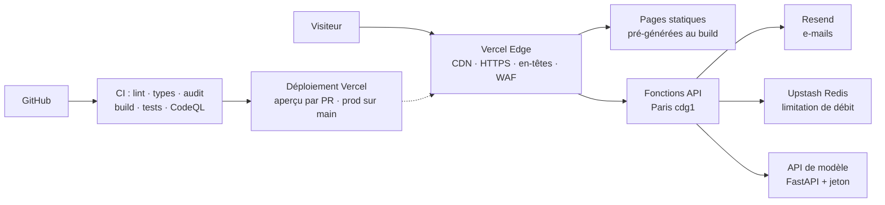

# Architecture

## Organisation du code

| Dossier | Rôle |
| --- | --- |
| `src/app/` | Pages et routes (App Router). Tout est statique sauf `/api/*`. |
| `src/app/api/contact` | Formulaire : origine, débit, taille, validation, envoi Resend. |
| `src/app/api/demo/[id]` | Proxy vers une API de modèle externe (liste blanche, jeton, timeout). |
| `src/app/api/health` | Sonde de disponibilité. |
| `src/content/` | Contenu : `site.ts` (profil), `projects/*.mdx`, `blog/*.mdx`. |
| `src/lib/` | Contenu validé (`content.ts`), env validé (`env.ts`), HTTP, anti-spam. |
| `src/islands/` | Composants interactifs (hero 3D, palette ⌘K, vue recruteur…). |
| `src/three/` | Scène WebGL : photo en relief + particules (shaders GLSL). |
| `src/demos/` | Démos exécutées dans le navigateur. |
| `src/config/security.ts` | Liste blanche des iframes (CSP + validation). |
| `scripts/` | Création de projet, tests de fumée. |

## Choix techniques

- **Statique d'abord** : les pages sont générées au build et servies par le CDN. Seules les routes `/api/*` s'exécutent à la demande. C'est rapide, économique et la surface d'attaque est minimale.
- **CSP sans nonce** : elle garde le rendu statique. Le site n'affiche aucun contenu fourni par les visiteurs, donc le risque XSS résiduel est très faible.
- **3D progressive** : la scène WebGL n'est chargée qu'après l'affichage de la page, seulement si l'appareil supporte WebGL et que le visiteur n'a pas demandé moins d'animations. Elle est mise en pause hors écran.
- **Contenu comme code** : chaque projet est un fichier MDX dont les métadonnées sont validées par zod au build. Un contenu invalide ne peut pas être publié.

## Scalabilité et rapidité

- **Lecture (99 % du trafic)** : pages HTML statiques servies par le CDN Vercel, mises en cache au plus près du visiteur. Le coût et le temps de réponse ne dépendent pas du nombre de visiteurs.
- **Écriture (formulaire, démos API)** : fonctions serverless sans état, qui montent en charge automatiquement. L'état partagé (compteurs anti-spam) vit dans Redis (Upstash), pas dans la fonction.
- **Médias** : polices auto-hébergées avec empreinte (cache permanent), images en cache 1 jour avec `stale-while-revalidate`, 3D chargée après l'affichage.
- **Sans état côté serveur** : aucune session, aucune base à migrer. Ajouter du trafic ne demande aucune action.

## Théorème CAP : choix par brique

En cas de partition réseau (P), un système distribué choisit entre cohérence (C) et disponibilité (A).

| Brique | Choix | Raison |
| --- | --- | --- |
| Pages et contenu | **AP** | Servies par le CDN multi-régions. Déploiements atomiques : pas de mélange de versions. |
| Anti-spam (Redis) | **AP** par défaut, **CP** configurable | `RATE_LIMIT_FAILURE_MODE=open` : si Redis est injoignable, compteur local (formulaire disponible, limite approximative). `closed` : refus 503 (limite exacte, formulaire indisponible). |
| Formulaire de contact | **CP** | Pas de stockage local : le message est transmis à Resend ou refusé avec une erreur explicite. Aucune perte silencieuse. |
| Démos intégrées | Sans état | Calcul dans le navigateur : pas d'état serveur, donc pas de compromis. |

L'état réel est visible sur `/api/health` (`checks.rateLimit` : `distributed` ou `local`, `checks.rateLimitOnFailure` : `AP` ou `CP`).
